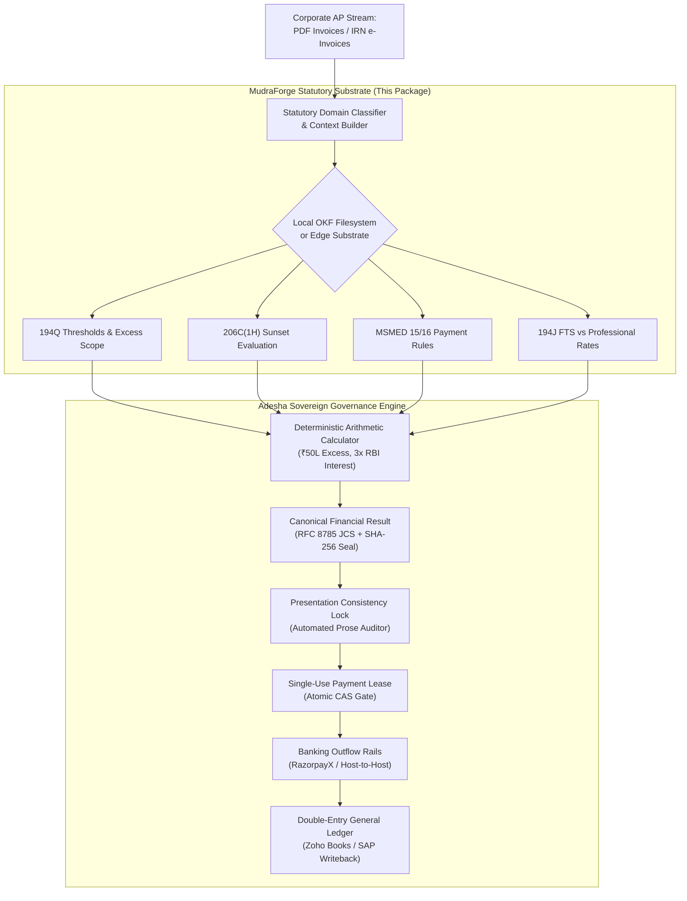

# MudraForge Statutory Architecture
## Grounding Financial AI in Deterministic Law & Open Knowledge

> **MudraForge Statutory Bundle**: `v2.4.0`  
> **Knowledge Specification**: Google Open Knowledge Format (OKF) specification (upstream v0.2)  
> **License**: MIT (Public Knowledge Commons)  
> **Status**: Public Beta  

---

## 1. Executive Summary & Problem Formulation

Large Language Models (LLMs) are stochastic token predictors. In corporate accounting, accounts payable automation, and ERP reconciliation, applying generative models directly to statutory compliance introduces a critical failure mode: **the conflation of generative reasoning with transactional and statutory authority**.

### The Failure Boundaries of LLMs in Tax Law

1. **Non-Linear Cumulative Thresholds**:
   Statutory tax provisions in India are non-linear and cumulative across financial years.
   *Example*: Under **Section 194Q** of the Income-tax Act, 1961, tax is deductible at 0.1% strictly on the *excess* purchase value over ₹50 Lakhs in a financial year. An LLM presented with an ₹80 Lakh invoice and ₹40 Lakhs of prior purchases frequently computes 0.1% on the full ₹80 Lakhs (₹8,000) instead of the statutory ₹70 Lakh taxable excess (₹7,000)—generating a persistent ₹1,000 tax over-deduction on a single transaction.

2. **Temporal Decay & Legislative Sunsets**:
   Statutory laws expire or are omitted by annual Finance Acts.
   *Example*: **Section 206C(1H)** was omitted by the Finance Act, 2025 effective 1 April 2025. Standard model weights continue citing and enforcing sunset sections long after their legal expiration date because pre-training data lacks temporal enforcement boundaries.

3. **Dual-Act Legislative Transition**:
   India is transitioning to the **Income-tax Act, 2025** (taking effect 1 April 2026), replacing familiar section numbers with new codifications (e.g., Section 194Q transitions to Section 393(1), Table 8, Item (ii)). Agents without a dual-act mapping layer hallucinate cross-statutory citations.

4. **The Failure of Messy Web Searches (Web RAG)**:
   When autonomous agents attempt to retrieve tax laws using automated search queries, they ingest conflicting third-party summaries: outdated SEO-optimized accounting blogs from 2018–2022, promotional vendor writeups, and unstructured discussion forums. These sources consistently miss crucial statutory provisos—such as CBDT Circular 13/2021 unbundling GST from TDS, or Ministry of MSME OM 2/1(5)/2021 excluding wholesale/retail traders. Web RAG introduces high latency, burns thousands of context tokens, and injects contradictory noise into agent reasoning.

5. **Having the Law ≠ Correct Interpretation (The Computation Boundary)**:
   Simply injecting the raw text of a statute into an LLM's context window does **not** ensure statutory compliance. LLMs are probabilistic token sequence predictors, not deterministic arithmetic engines. When an LLM reads Section 194Q or MSMED Section 16, it frequently miscalculates multi-invoice cumulative threshold tracking or monthly compound interest, and defends its erroneous math when challenged (**The Epistemic Confirmation Loop**). Statutory law requires a strict boundary between legal knowledge and mathematical execution.

---

## 2. Architectural Principle: Sovereign Separation of Powers

To resolve these vulnerabilities, MudraForge enforces a strict **Separation of Powers**:

```
┌────────────────────────────────────────────────────────────────────────┐
│ 1. Generative Layer (AI Agents / LLMs)                                 │
│    • Assists, extracts messy invoice narrative, and explains context   │
│    • Strictly prohibited from authoritative financial computation      │
└──────────────────────────────────▲─────────────────────────────────────┘
                                   │ Queries local disk / edge
┌──────────────────────────────────┴─────────────────────────────────────┐
│ 2. Statutory Knowledge Substrate (OKF Layer - This Package)            │
│    • Authoritative, versioned reference law under Google's OKF standard│
│    • Temporal validity state machines (detects sunsets & transitions)  │
│    • Zero dependencies, 100% offline-capable, sub-1ms local lookup     │
└──────────────────────────────────▲─────────────────────────────────────┘
                                   │ Feeds verified ground truth
┌──────────────────────────────────┴─────────────────────────────────────┐
│ 3. Deterministic Execution & Governance (Adesha Runtime)               │
│    • Pure arithmetic legal calculators (194Q excess, MSMED 3x RBI)     │
│    • Single-use payment leases, CAS gates & Two-Generals recovery      │
│    • Double-entry general ledger writeback with source-bound lines     │
└────────────────────────────────────────────────────────────────────────┘
```

> **Core Postulate**: *The Generative AI assists, analyzes, and explains; the Deterministic Runtime computes, gates, authorizes, executes, and reconciles.*

---

## 3. The Open Knowledge Format (OKF) Implementation

The foundation of the statutory knowledge layer is the **Open Knowledge Format (OKF)**, an open specification introduced by Google Cloud as the "OpenAPI for Knowledge" (upstream specification: v0.2).

Rather than forcing developers and AI agents to query external vector databases or inject large RAG prompts, the OKF represents legal ground truth as a versioned, portable filesystem of human- and agent-readable files.

### Domain-Structured Filesystem Architecture

Statutes in `./okf/` are structured by **regulatory domain** with dedicated sub-directories containing the core statute schema, official executive circulars in Google OKF Markdown, and statutory compliance forms:

```
okf/
├── manifest.json                                      # Cryptographic SHA-256 root hash & domain manifest
│
├── direct_tax/
│   ├── tds_goods_194q/
│   │   ├── section.json                               # 0.1% TDS on purchase excess over ₹50L
│   │   ├── circulars/
│   │   │   ├── cbdt_circular_13_2021_guidelines.md    # CBDT Q&A on threshold math & advance netting
│   │   │   └── cbdt_circular_23_2017_gst_unbundling.md# Exclusion of GST from TDS base
│   │   └── forms/
│   │       ├── form_26q_quarterly_return.json         # Form 26Q quarterly TDS reporting schema
│   │       └── vendor_pan_declaration.md              # Vendor PAN & Section 206AB declaration template
│   ├── tds_services_194j/
│   │   ├── section.json                               # 2% FTS vs 10% Professional fees
│   │   ├── circulars/
│   │   │   └── cbdt_circular_03_2020_fts_rate_cut.md  # FTS 2% rate reduction guidelines
│   │   └── forms/
│   │       └── form_16a_tds_certificate.json          # Form 16A quarterly TDS certificate schema
│   └── tcs_goods_206c_1h/
│       ├── section.json                               # Section 206C(1H) sunset on 1 April 2025
│       └── circulars/
│           └── finance_act_2025_sunset_memo.md        # Finance Act 2025 omission memo
│
├── indirect_tax_gst/
│   └── blocked_itc_17_5/
│       ├── section.json                               # CGST 17(5) blocked credit negative list
│       ├── circulars/
│       │   └── cbic_circular_172_2022_employer_obligations.md # Statutory employer obligation exception
│       └── forms/
│           └── gstr_2b_ineligible_reconciliation.json # GSTR-2B vs 3B Table 4(B) reporting schema
│
├── msme_commercial/
│   └── delayed_payments_15_16/
│       ├── section.json                               # 45-day clock, 3x RBI interest & 43B(h)
│       ├── circulars/
│       │   └── msme_om_2021_trader_exclusion.md       # Retail/wholesale trader exclusion rule
│       └── forms/
│           ├── udyam_registration_verification.json   # UDYAM portal certificate validation schema
│           └── schedule_iii_msme_disclosure.md        # Balance Sheet Schedule III disclosure format
│
└── international_tax/
    └── foreign_tax_credit_irc_901_904/
        ├── section.json                               # US Foreign Tax Credit limitation baskets
        └── forms/
            ├── form_67_statement_of_foreign_tax.json  # Indian Income Tax Form 67 (Rule 128)
            └── irs_schedule_k3_reporting.json         # US IRS Schedule K-3 dual-reporting schema
```

### Zero-Token Agent Discovery
When an autonomous agent (Antigravity, Cursor, Claude Code) receives a compliance task:
1. The agent reads the directory listing of `./okf/` (organized by regulatory domains).
2. The combination of section code and plain-text description allows the agent to identify the applicable statute at **0 token cost** without RAG hallucinations.
3. The agent loads only the targeted JSON statute into context.

### Dual-Act Legislative Migration Matrix
The OKF embeds a cross-compilation matrix forward-mapping the *Income-tax Act, 1961* to the *Income-tax Act, 2025*:
- `194Q` $\rightarrow$ Section 393(1), Table 8, Item (ii)
- `194J` $\rightarrow$ Section 393(1), Table 8, Item (iii)
- `194C` $\rightarrow$ Section 393(1), Table 8, Item (i)

Transactions dated before 1 April 2026 resolve under the 1961 Act; transactions on or after 1 April 2026 automatically compile under the 2025 Act codification.

---

## 4. Financial Regulatory Domains Currently Supported

The OKF statutory substrate is purpose-built for **corporate finance departments, enterprise accounts payable (AP), treasury controllers, and tax compliance teams**.

Currently, the substrate indexes and provides deterministic ground truth across four vital financial domains:

### 1. Direct Tax & Corporate Withholdings (TDS / TCS)
- **Section 194Q**: 0.1% TDS on purchase of goods exceeding ₹50 Lakhs cumulative annual threshold (calculating strictly on the excess over ₹50L).
- **Section 206C(1H)**: TCS on sale of goods, with automated temporal interception of its **1 April 2025 sunset** under the Finance Act, 2025.
- **Section 194J**: Fees for Technical Services (2% FTS) vs. Professional Fees (10%), handling 5% non-PAN penalty rates.
- **Dual-Act Forward Mapping**: Complete cross-compilation matrix from *Income-tax Act, 1961* to the upcoming *Income-tax Act, 2025* (taking effect 1 April 2026), mapping sections seamlessly (e.g., Section 194Q → Section 393(1), Table 8, Item (ii)).

### 2. Indirect Tax & Procurement Compliance (GST)
- **CGST Section 17(5)**: Comprehensive statutory negative list for Blocked Input Tax Credit (ITC)—including motor vehicles, corporate food & beverages, personal consumption, club memberships, and statutory exceptions/provisos.

### 3. Micro, Small & Medium Enterprises (MSME Working Capital & Section 43B(h))
- **MSMED Act, 2006 (Sections 15 & 16)**: Strict statutory payment clock (15 days without agreement, max 45 days with written agreement) and non-negotiable compound penal interest at **3 times the RBI Bank Rate** (compounded monthly).
- **Trader Exclusion Rule**: Automated enforcement of Ministry of MSME OM No. 2/1(5)/2021-P&G/Policy, strictly excluding wholesale and retail traders (NIC 45, 46, 47) from delayed payment protection.
- **Income Tax Linkage**: Cross-statutory disallowance rules under Section 43B(h) for overdue vendor payables.

### 4. Cross-Border Remittances & Dual-Reporting
- **US Internal Revenue Code (IRC §§ 901 & 904)**: Foreign Tax Credit (FTC) limitation baskets (General Category vs. Passive Category), Pass-Through Entity (PTE) tax pass-throughs, and Schedule K-3 dual-reporting compliance for Indo-US cross-border ventures.

---

## 5. Requesting New Statutes & Expanding Legal Domains

Enterprise finance operations are broad, and finance teams frequently encounter specialized regulatory frameworks beyond the initial core set.

**Do you need support for an additional tax domain or statutory provision?**
Examples of sections and domains we are actively indexing or can prioritize on request:
- **International & Transfer Pricing**: Section 92E / Master File / Local File compliance.
- **Digital Economy Taxes**: Equalisation Levy (Section 165) and Section 194S (Crypto/VDA TDS).
- **Lower Deduction Certificates**: Section 197 / Section 195 certificate exhaustion monitoring.
- **State-Specific Compliance**: State Stamp Duty acts, Professional Tax, and State GST variations.
- **Cross-Border Jurisdictions**: UK Corporation Tax (HMRC), Singapore IRAS GST, or US State Apportionment / Sales Tax Nexus.

### How to Request a Statute or Legal Domain:
1. **GitHub Issues**: Open an issue on [`github.com/mondeep0123/mudraforge-statutory`](https://github.com/mondeep0123/mudraforge-statutory/issues) using the `statute-request` or `domain-support` label. Include the governing statute, section number, and primary CBDT/CBIC/regulatory citations.
2. **Direct Contact**: Email our engineering and tax research team at [hello@mudraforge.in](mailto:hello@mudraforge.in) or [support@mudraforge.in](mailto:support@mudraforge.in).
3. **CA & Legal Practitioner Empanelment**: If you are a Chartered Accountant (CA), CPA, or tax attorney and want to co-author, audit, or review statutory packs with official attribution and review records, reach out directly to Mondeep Engti at [mondeepe@gmail.com](mailto:mondeepe@gmail.com).

---

## 6. How the Knowledge Layer Connects to Adesha

The statutory substrate published in this repository (`@mudraforge/statutory`) acts as the reference oracle for the broader **MudraForge Adesha Governance Platform**:



### Subsystem Boundary Delineation

| Capability | Public Substrate (`@mudraforge/statutory`) | Commercial Adesha Platform |
| :--- | :--- | :--- |
| **Statutory Text & Schemas** | Supported (Open Knowledge Format / MIT) | Included & Maintained |
| **Offline Filesystem Lookup** | Supported (Sub-1ms local traversal, 0 network calls) | Included |
| **Agent Skill (`SKILL.md`)** | Supported (`init-skill` CLI) | Included |
| **Maintenance & Gazette Updates**| Static public release snapshot | Continuous edge synchronization |
| **Deterministic Tax Math** | Reference metadata only | Gated Edge API (`POST /calculate`) |
| **Payment Authorization Leases**| Excluded | Single-use cryptographic CAS leases |
| **Banking Reconciliation** | Excluded | Two-Generals failure recovery |
| **ERP Ledger Writeback** | Excluded | Source-bound double-entry writeback |

---

## 7. Working Example: Offline Local Traversal

The public package allows developers and agents to traverse statutory law with zero external network requests:

```javascript
import { lookupLocalStatute, isStatuteActive } from '@mudraforge/statutory';

// 1. Look up Section 194Q offline (sub-1ms)
const statute = lookupLocalStatute('194Q');
console.log(statute.title);
console.log(statute.keyStatutoryThresholds.taxableBaseScope);
// => "Tax is deductible strictly on the excess over ₹50 Lakhs, NOT on the aggregate gross turnover."

// 2. Check temporal status against effective dates
const isActive2024 = await isStatuteActive('206C(1H)', '2024-05-01'); // true
const isActive2025 = await isStatuteActive('206C(1H)', '2025-06-01'); // false (sunset effective 1 April 2025)
```

---

## 8. Public Commons vs. Commercial Lifecycle & Sustainability Policy

### 8.1 Free Edge Updates Supported During Public Beta
During the **Public Beta**, both the local reference substrate and the Cloudflare Anycast edge synchronization endpoints (`check-update` and `sync`) are **100% free and unauthenticated**. 

Developers, compliance engineers, and AI agents can execute:
```bash
# Check if new statutory releases or gazette amendments exist on edge
npx @mudraforge/statutory check-update

# Automatically sync latest statutory JSON files directly into local ./okf/
npx @mudraforge/statutory sync
```
No API key or commercial contract is required to synchronize and update your local OKF knowledge files throughout the beta window.

### 8.2 The Economic Rationale for Moving Live Updates to Paid (Sustainability)
Statutory compliance is fundamentally different from typical open-source libraries. Code libraries can remain unchanged for years; **statutory tax law is a living, actively amended legal regime**:
- **Annual Finance Acts & Budget Enactments**: The Indian Parliament revises withholding rates, introduces new statutory regimes, and sunsets obsolete provisions annually (such as the explicit sunset of Section 206C(1H) on 1 April 2025, and the complete transition to the *Income-tax Act, 2025* taking effect 1 April 2026).
- **Executive Circulars & Notifications**: The Central Board of Direct Taxes (CBDT) and Central Board of Indirect Taxes and Customs (CBIC) issue monthly circulars altering threshold definitions, unbundling requirements (e.g. GST unbundling under Circular 13/2021), and procedural exclusions.
- **Appellate & Supreme Court Precedents**: High Court, Supreme Court, and ITAT judgments continuously refine the legal boundaries of terms such as "composite supply", "pure agent", or "trader exclusions".

Operating a verified, tamper-evident statutory oracle requires **continuous legal engineering, daily Gazette of India monitoring, Chartered Accountant peer review, formal state machine testing (TLA+), and globally distributed Anycast edge infrastructure**.

Treating statutory maintenance as an unfunded volunteer project invariably produces stale, hallucinated legal data—the exact failure mode that causes catastrophic multi-crore enterprise tax disallowances. 

**To make this continuous legal surveillance and versioned maintenance sustainable for the long term without compromising epistemic rigor**, live automated versioning updates (`sync` and `check-update`) will transition to the paid Enterprise API tier once the Public Beta concludes.

### 8.3 Perpetual MIT License Guarantee
- **The Local Snapshot Remains Free Forever**: Every statutory file and manifest downloaded or cloned under the MIT license remains permanently free for offline traversal, local agent skills, and internal experimentation.
- **No Vendor Lock-In**: Organizations are free to maintain, inspect, and fork their local `./okf/` directories indefinitely.

---

### 8.4 Edge Consistency & Immutable Release Strategy (Cloudflare KV)

Cloudflare Workers KV is a globally distributed, eventually consistent storage layer across 300+ points of presence (PoPs). In statutory finance, serving inconsistent states during an active release rollout (e.g. one edge PoP serving an amended 0.1% TDS rate while another serves an outdated 1% rate) introduces compliance risk.

To prevent version skew across regions, the edge runtime employs an **Immutable Release Key Pattern**:

1. **Immutable Artifact Keys**: Every section schema, circular, and form is stored under an immutable, version-tagged key:
   ```
   statutory:releases:<semver>:<domain>:<section_code>
   # Example: statutory:releases:v2.4.0:direct_tax:194Q
   ```
   Once written to KV, the bytes for a specific semver key are permanently immutable.
2. **Atomic Manifest Pointers**: Releases are indexed by a versioned root manifest (`statutory:manifests:v2.4.0`). The active pointer is switched only after all constituent keys are fully populated.
3. **Cache Invalidation & ETag Gates**: The manifest endpoint serves HTTP `ETag` validators with short edge TTLs (`Cache-Control: public, max-age=60, s-maxage=300, stale-while-revalidate=600`). This ensures edge caches converge globally within minutes while allowing clients to detect release changes via deterministic SHA-256 root hash comparisons.
- **Commercial Boundary**: Only the automated, continuously maintained edge update stream, neural discovery search, and deep deterministic calculator engines require an Enterprise API subscription post-beta.

---

## 9. Related Documents

- [`DOMAIN_BREADTH_AND_DEPTH_COMPARISON.md`](./DOMAIN_BREADTH_AND_DEPTH_COMPARISON.md) — Authoritative matrix comparing the 4 starter domains against the full 11-domain sovereign roadmap.
- [`VERIFICATION.md`](./VERIFICATION.md) — Formal verification report, TLA+ state machine model, mutation tests, and documented limitations.
- [`ENTERPRISE_GOVERNANCE.md`](./ENTERPRISE_GOVERNANCE.md) — The Adesha governance architecture: single-use payment leases, Two-Generals banking recovery, and ERP writebacks.
- [`README.md`](./README.md) — Quickstart, CLI commands, and installation guide.
