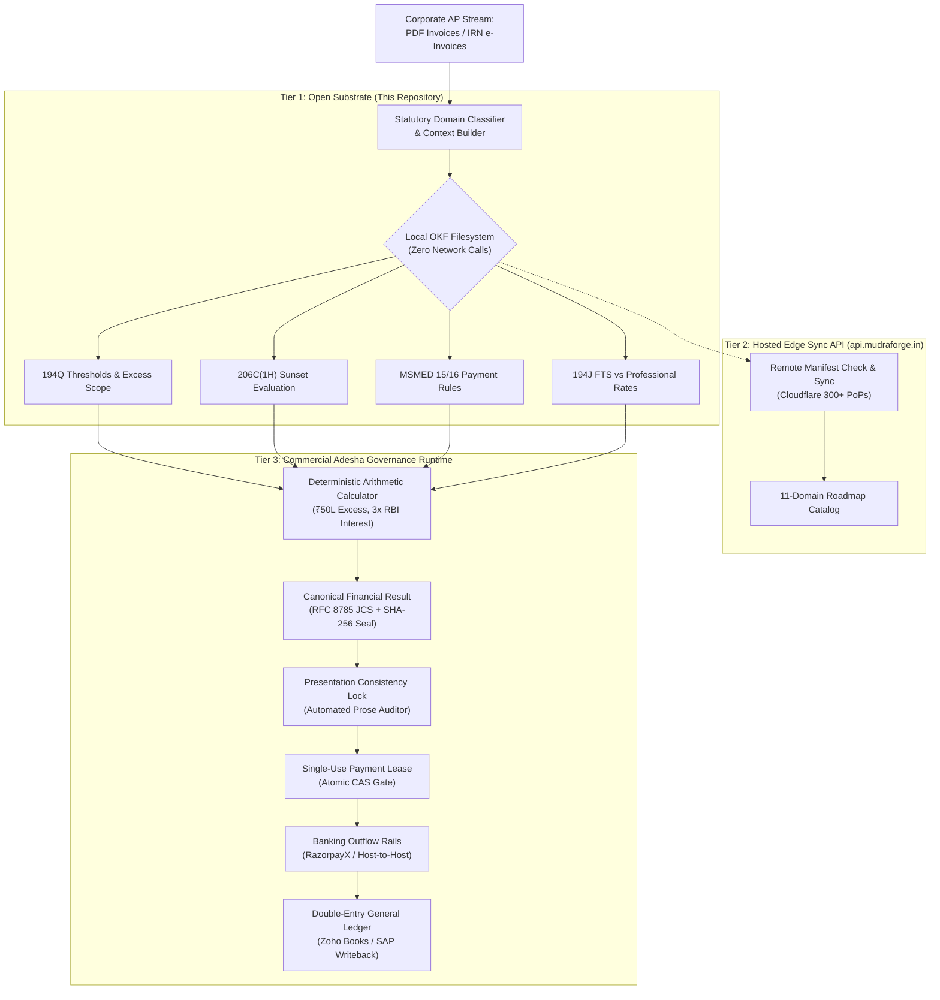

# MudraForge Statutory Architecture
## Grounding Financial AI in Deterministic Law & Open Knowledge

> **MudraForge Statutory Bundle**: `v2.10.0`  
> **Knowledge Specification**: Google Open Knowledge Format (OKF) specification (upstream v0.2)  
> **License**: MIT (Public Knowledge Commons)  
> **Status**: Public Beta  

---

## 1. Executive Thesis: The Payment Instruction Boundary

> **The Dangerous Moment in Finance AI**:  
> *The dangerous moment in finance AI isn't when the model is wrong. It's when its output becomes a payment instruction.*
> 
> In marketing, an AI hallucination is a typo. In accounts payable, an unhandled bank timeout can trigger a retry that double-pays a vendor.
> 
> Hardening the financial runtime for **Adesha, MudraForge's organizational AI**, our principle is simple:  
> **Reasoning can be probabilistic, but financial execution needs deterministic boundaries.**

---

## 2. The Four Pillars of Autonomous Finance Execution

To ensure financial workflows remain resilient against model confabulation, concurrent API races, and network failures, the MudraForge architecture is grounded in four operational pillars:

### Pillar 1: Retrieval is Not Verification
Early on, prototype compliance validators relied on pre-populated test files holding expected answers. We scrapped that crutch. Real-world accounting cannot trust static assumptions.

Our tests now exercise live retrieval from connected systems of record (including live Zoho Books / SAP ERP readback) and authenticated tenant statutory vaults. Finding a document or matching keywords is not legal verification; the system must verify what evidence legally supports before any downstream calculation runs or any payment lease is minted.

### Pillar 2: Safe Tools Do Not Guarantee Safe Workflows
An AI agent can call individually safe API tools and still coordinate an unauthorized or illegal transaction (e.g., deducting tax on an exempt unit or paying an altered beneficiary account).

We enforce an absolute separation between reasoning and execution:
- **Generative AI Layer**: Coordinates investigations, clarifies unstructured context, and extracts messy invoice narratives.
- **Deterministic Execution Engine**: Evaluates statutory tax thresholds, computes paisa-level withholding, and enforces ledger invariants.
- **Statutory Provenance**: Human oversight must not mean accountants re-auditing arithmetic; the runtime provides verifiable statutory provenance so human officers can focus on the actual business decision.

> **Rule 11**: *Agreement with the Engine ≠ Agreement with the Law.*  
> Never confuse an agent adhering to tool output with true statutory correctness. If the underlying statutory baseline is flawed, 100% agent adherence merely guarantees that the agent faithfully repeats a flawed calculation. Statutory thresholds and effective dates must be enforced by deterministic calculator functions, never left to ungrounded LLM text generation.

### Pillar 3: Preventing Silent Financial Drift
Deterministic code computes numbers. RFC 8785 JSON Canonicalization Scheme (JCS) and SHA-256 bind the calculation result to a verifiable, immutable fingerprint:
```
Calculation Result ──► RFC 8785 Canonicalization ──► SHA-256 Fingerprint
```
The cryptographic hash does not perform math—it detects any alteration between calculation, human authorization, and banking execution. If an invoice total, vendor account, or tax deduction is altered anywhere in the workflow, the fingerprint mismatch immediately halts execution before payment dispatch.

### Pillar 4: Testing Payment Boundaries Against Failure
- **Duplicate-Payment Prevention**: Single-use Compare-and-Swap (CAS) leases are tested under concurrent races using MongoDB-compatible atomic operations (`findAndModify`): exactly one consumer consumes the lease successfully; all concurrent races are rejected with `LEASE_ALREADY_CONSUMED`.
- **Formal TLA+ State Machine Modeling**: The TLC Model Checker explored all 361 reachable states in our configured distributed model (covering two concurrent leases, retries, and network timeouts) with zero invariant violations, and caught four deliberate defects injected into the formal specification.
- **Edge Execution**: Built on Cloudflare Workers V8 isolates, eliminating container cold starts and sandbox vulnerabilities.
- **Accounting Integrity**: Adversarial test suites target unbalanced journals, duplicate credits, and amount mismatches, enforcing paisa-level equilibrium before ERP writeback.

---

## 3. End-to-End AP Architecture: From Statutory Law to Bank Settlement

The journey of an accounts payable transaction from incoming PDF invoice to general ledger reconciliation traverses seven strict governance stages (`npm run example:trace`):

```
┌────────────────────────────────────────────────────────────────────────┐
│ STAGE 1: INVOICE INGESTION                                             │
│ Incoming PDF / IRN e-Invoice QR code parsed and verified.              │
│ (Basic: INR 60,00,000 | GST 18%: INR 10,80,000 | Gross: INR 70,80,000) │
└───────────────────────────────────┬────────────────────────────────────┘
                                    ▼
┌────────────────────────────────────────────────────────────────────────┐
│ STAGE 2: OKF RULE RESOLUTION (This Package - Zero Network Calls)       │
│ Offline local lookup identifies Section 194Q & successor Act 2025.     │
│ Threshold: INR 50,00,000 | Standard Rate: 0.1% | Excess Base Only      │
└───────────────────────────────────┬────────────────────────────────────┘
                                    ▼
┌────────────────────────────────────────────────────────────────────────┐
│ STAGE 3: DETERMINISTIC STATUTORY COMPUTATION (Arithmetic Engine)       │
│ Prior FY Purchases: INR 45,00,000 | Cumulative: INR 1,05,00,000        │
│ Taxable Excess: INR 55,00,000 | GST Unbundled (Circular 13/2021)       │
│ TDS Deducted: INR 5,500 | Net Payable to Vendor: INR 70,74,500         │
└───────────────────────────────────┬────────────────────────────────────┘
                                    ▼
┌────────────────────────────────────────────────────────────────────────┐
│ STAGE 4: CRYPTOGRAPHIC PAYMENT AUTHORIZATION LEASE (Adesha CAS Gate)   │
│ Single-Use Token: sha256-4f9e8a71... | Max Authorized: INR 70,74,500   │
│ State: LEASE_ISSUED_UNCONSUMED (Atomic lock prevents re-execution)     │
└───────────────────────────────────┬────────────────────────────────────┘
                                    ▼
┌────────────────────────────────────────────────────────────────────────┐
│ STAGE 5: HUMAN-IN-THE-LOOP AUTHORITY HARNESS (Mobile / Biometric)      │
│ CFO reviews verifiable statutory provenance on mobile authority app.   │
│ Decision: APPROVED | Transition: AUTHORIZED_FOR_SETTLEMENT             │
└───────────────────────────────────┬────────────────────────────────────┘
                                    ▼
┌────────────────────────────────────────────────────────────────────────┐
│ STAGE 6: BANK RAIL DISBURSEMENT (Host-to-Host Corporate RTGS)          │
│ Payout dispatched via banking gateway. HTTP 200 settled confirmed.     │
│ Bank UTR: SIMULATED-RTGS-UTR-2026-891 | Disbursed: INR 70,74,500       │
└───────────────────────────────────┬────────────────────────────────────┘
                                    ▼
┌────────────────────────────────────────────────────────────────────────┐
│ STAGE 7: GENERAL LEDGER BALANCED DOUBLE-ENTRY WRITEBACK (ERP)          │
│ Balanced Journal Entry (JV-2026-04-0042) posted to ERP (SAP / Zoho):   │
│   [DEBIT ] Purchases / Cost of Goods Sold       INR 60,00,000.00       │
│   [DEBIT ] Input CGST Receivable (9%)           INR  5,40,000.00       │
│   [DEBIT ] Input SGST Receivable (9%)           INR  5,40,000.00       │
│   [CREDIT] TDS Payable under Section 194Q       INR      5,500.00      │
│   [CREDIT] Bank Operating Account               INR 70,74,500.00       │
│ Equilibrium: PAISA_LEVEL_PERFECT_BALANCE (Discrepancy: INR 0.00)       │
└────────────────────────────────────────────────────────────────────────┘
```

> **Reproduce This Execution Trace Locally**:  
> You can run the audited 7-stage execution simulation locally in your terminal:  
> ```bash
> npm run example:trace
> ```

### 3.1 Stage 1: Invoice Ingestion & Cryptographic Ingestion Gate
- **Operational Purpose**: Ingests, normalizes, and cryptographically validates incoming vendor billing payloads from heterogeneous channels (PDF documents, scanned paper, structured EDI feeds, and B2B GST e-Invoices).
- **Inbound Data Contract**:
  - `invoicePayload`: Raw image/PDF bytes or structured JSON payload.
  - `irnQrPayload`: Base64-encoded CBIC/NIC e-invoice QR code string (for B2B invoices exceeding mandatory e-invoicing thresholds).
  - `metadata`: Source channel, ingest timestamp, and receiving tenant ID.
- **Cryptographic Gate & Ingestion Mechanics**:
  1. *QR Code Public Key Verification*: Extracts the signed JWT embedded within the 500-character QR code. The digital signature is validated against the National Informatics Centre (NIC) public certificate, certifying that the Invoice Reference Number (IRN), GSTIN of supplier/buyer, invoice date, and item totals were registered on the government portal.
  2. *Line-Item Decomposition & Arithmetic Balancing*: Normalizes itemized line items, verifying strict paisa-level equality:
     $$\text{Gross Total} \equiv \sum \text{Line Taxable Values} + \sum \text{CGST} + \sum \text{SGST/UTGST} + \sum \text{IGST} + \sum \text{Cess} \pm \text{INR } 0.00$$
  3. *Replay Protection Check*: Queries historical transaction ledger for existing IRN hash or `(supplier_gstin, invoice_number, fiscal_year)` tuple.
- **Outbound Payload**: Normalized `IngestedInvoice` structure pinned with an immutable `invoiceDigest` (SHA-256).
- **Failure Modes & Degradation Handling**:
  - `ERR_INVALID_QR_SIGNATURE`: Cryptographic signature mismatch. Invoice is rejected; processing halts with security alert.
  - `ERR_ARITHMETIC_MISMATCH`: Line item sums diverge from header gross amount. Execution suspended for human accounting review.
  - `ERR_DUPLICATE_IRN_DETECTED`: Invoice replay detected. Aborts immediately to prevent duplicate bill processing.

### 3.2 Stage 2: OKF Rule Resolution Substrate (Zero-Network Subsystem)
- **Operational Purpose**: Resolves the applicable legal provisions, circular guidelines, and compliance schemas directly from the local Open Knowledge Format (OKF) filesystem with zero network calls and sub-millisecond deterministic latency.
- **Inbound Data Contract**:
  - `transactionContext`: Supplier type, buyer corporate turnover, goods vs. services classification, and line item HSN/SAC codes.
  - `transactionDate`: ISO 8601 execution timestamp (e.g., `2026-04-23T10:00:00Z`).
- **Resolution Pipeline & Temporal Mechanics**:
  1. *Statute Routing*: Maps transaction context to the authoritative regulatory domain (e.g., `direct_tax/tds_goods_194q`).
  2. *Zero-Network Local Traversal*: Reads `./okf/direct_tax/tds_goods_194q/section.json` from the local filesystem or isolated edge memory.
  3. *Temporal State Machine Evaluation*:
     - Verifies `transactionDate >= section.effectiveFrom`.
     - Evaluates `section.sunsetDate`. If $\text{transactionDate} \ge \text{sunsetDate}$ (as with Section 206C(1H) on 1 April 2025), transitions status to `SUNSET_SUPERSEDED` and halts execution.
     - Evaluates `section.successorAct2025Mapping`. If $\text{transactionDate} \ge \text{2026-04-01}$, cross-compiles citation to the *Income-tax Act, 2025* codification (e.g. Section 194Q $\rightarrow$ Section 393(1), Table 8, Item (ii)).
- **Outbound Payload**: Immutable `StatutoryRuleSnapshot` containing thresholds, rates, circular provisos, and successor mapping.
- **Failure Modes & Degradation Handling**:
  - `ERR_SECTION_NOT_FOUND`: Specified statutory provision not indexed in active OKF manifest.
  - `ERR_STATUTE_SUNSET_EXPIRED`: Transaction attempted against an expired or omitted legal section.
  - `ERR_UNMAPPED_SUCCESSOR`: Transaction date falls into the 2025 Act era without an explicit statutory cross-reference.

### 3.3 Stage 3: Deterministic Statutory Computation Engine
- **Operational Purpose**: Executes statutory arithmetic in strictly isolated, deterministic code using integer paisa. Generative LLMs are barred from performing this arithmetic (Rule 11).
- **Inbound Data Contract**:
  - `ingestedInvoice`: Verified invoice amounts, item breakdown, and vendor PAN.
  - `statutorySnapshot`: Applicable OKF rule parameters (thresholds, statutory rates, penalty escalations).
  - `ledgerHistory`: Verified historical purchases from the same vendor within the active financial year.
- **Deterministic Computation Algorithms**:
  1. *Cumulative Threshold Evaluation (Section 194Q)*:
     - Retrieves cumulative prior FY purchases from the verified ERP ledger: $\text{Prior Purchases} = \text{INR } 45,00,000$.
     - Computes cumulative aggregate: $\text{Cumulative} = 45,00,000 + 60,00,000 = \text{INR } 1,05,00,000$.
  2. *GST Unbundling & Taxable Base Netting*:
     - Strictly enforces CBDT Circular 13/2021 and Circular 23/2017: GST components (CGST/SGST/IGST) are excluded from the withholding base when charged separately.
     - Computes marginal taxable excess:
       $$\text{Taxable Excess} = \max(0, \min(\text{Basic Value}, \text{Cumulative} - 50,00,000)) = \text{INR } 55,00,000$$
  3. *PAN Compliance & Penalty Rate Interception*:
     - Inspects vendor PAN validity and Section 206AB compliance. If PAN is valid and active, standard rate ($0.1\%$) applies:
       $$\text{TDS Deducted} = \lfloor 55,00,000 \times 0.001 \rfloor = \text{INR } 5,500$$
     - If PAN is inoperative or specified non-filer, automatically elevates rate to 5% u/s 206AA/206AB.
  4. *Net Payable Allocation*:
     $$\text{Net Payable to Vendor} = \text{Gross Invoice Total} - \text{TDS Deducted} = 70,80,000 - 5,500 = \text{INR } 70,74,500$$
- **Outbound Payload**: Canonical `StatutoryCalculationResult` detailing basic value, unbundled taxes, taxable excess, deduction, and net payable.
- **Failure Modes & Degradation Handling**:
  - `ERR_NEGATIVE_TAXABLE_BASE`: Negative purchase value or invalid credit note netting.
  - `ERR_PAN_INOPERATIVE_MANDATORY_ELEVATION`: Vendor PAN inoperative, requiring mandatory 5% withholding rate escalation.
  - `ERR_MISSING_FY_PURCHASE_HISTORY`: Ledger purchase history unretrievable, preventing deterministic threshold calculation.

### 3.4 Stage 4: Cryptographic Payment Authorization Lease (Adesha CAS Gate)
- **Operational Purpose**: Converts the computed financial calculation into a single-use, cryptographically sealed authorization lease. Enforces the payment instruction boundary and guarantees single-execution semantics under concurrent distributed races.
- **Inbound Data Contract**:
  - `calculationResult`: Deterministic statutory calculation numbers.
  - `disbursementTarget`: Verified vendor beneficiary account, IFSC code, and legal entity identifier.
- **Cryptographic Binding & Atomic CAS Mechanics**:
  1. *RFC 8785 JSON Canonicalization Scheme (JCS)*: Normalizes the calculation payload to remove whitespace and key ordering variance:
     $$\text{Canonical JSON} = \text{JCS}(\text{CalculationPayload})$$
  2. *SHA-256 Fingerprint Binding*: Mints a unique transaction fingerprint:
     $$\text{transactionFingerprint} = \text{SHA-256}(\text{Canonical JSON})$$
  3. *Atomic Single-Use Compare-and-Swap (CAS) Minting*: Inserts lease into distributed state storage (MongoDB/KV) under status `LEASE_ISSUED_UNCONSUMED`:
     ```javascript
     const lease = {
       leaseId: "lease_sec194q_2026_04_9921",
       transactionFingerprint: "sha256-4f9e8a71...",
       vendorAccountHash: "sha256-992a...",
       maxAuthorizedAmountPaisa: 707450000,
       status: "LEASE_ISSUED_UNCONSUMED",
       expiresAt: "2026-04-23T12:00:00Z"
     };
     ```
  4. *Concurrency Defense*: When a disbursement process claims the lease, it executes an atomic `findOneAndUpdate` matching `status: LEASE_ISSUED_UNCONSUMED`. Exactly one consumer succeeds; any concurrent thread, worker retry, or duplicate webhook fails with `LEASE_ALREADY_CONSUMED`.
- **Outbound Payload**: Cryptographic `PaymentAuthorizationLease` ready for human officer review.
- **Failure Modes & Degradation Handling**:
  - `ERR_FINGERPRINT_TAMPER_DETECTED`: Invoice payload or vendor account modified after computation.
  - `ERR_LEASE_ALREADY_CONSUMED`: Replay or concurrent payment attempt detected.
  - `ERR_LEASE_TTL_EXPIRED`: Lease expired before human authorization and settlement.

### 3.5 Stage 5: Human-in-the-Loop Authority Harness
- **Operational Purpose**: Presents verifiable statutory provenance and financial breakdowns to authorized corporate officers (CFO, Controller), ensuring human oversight without requiring manual arithmetic recalculation.
- **Inbound Data Contract**:
  - `paymentLease`: Cryptographic lease token with `transactionFingerprint`.
  - `statutoryProvenance`: Full execution trace linking statutory section, circular citations, and threshold math.
- **Presentation Consistency Lock & Cryptographic Verification**:
  1. *Presentation Consistency Lock*: Any narrative or explanatory text generated by AI agents to summarize the invoice is verified against the canonical calculation. If the text description misstates a single number, the approval UI locks out.
  2. *Biometric & Cryptographic Co-Signing*: The authorizing officer approves the lease using WebAuthn / FIDO2 hardware enclaves on mobile or desktop devices.
  3. *Dual-Control Risk Escalation*: Transactions exceeding enterprise policy thresholds (e.g., > INR 50,00,000) mandate two independent authorized signatures (e.g., Finance Controller + CFO).
- **Outbound Payload**: Cryptographically signed `ApprovedPaymentLease` transitioning to `AUTHORIZED_FOR_SETTLEMENT`.
- **Failure Modes & Degradation Handling**:
  - `ERR_PRESENTATION_LOCK_VIOLATION`: AI explanatory prose conflicts with canonical lease numbers.
  - `ERR_DUAL_KEY_SIGNATURE_MISSING`: Second authorized signature absent for transactions above risk threshold.
  - `ERR_BIOMETRIC_TOKEN_INVALID`: WebAuthn / FIDO2 cryptographic assertion failed verification.

### 3.6 Stage 6: Bank Rail Disbursement & Two-Generals Recovery
- **Operational Purpose**: Dispatches the payout instruction to host-to-host corporate banking rails (RTGS/NEFT/IMPS) and idempotently recovers from network partitions, timeouts, and unacknowledged API states.
- **Inbound Data Contract**:
  - `approvedLease`: Verified lease with valid officer signatures.
  - `bankCredentials`: Corporate host-to-host banking gateway tokens with mutual TLS 1.3 certificates.
- **Disbursement Protocol & Two-Generals Recovery**:
  1. *Deterministic Idempotency Key*: Bank payout request headers inject:
     $$\text{X-Idempotency-Key} = \text{lease.transactionFingerprint}$$
  2. *Execution & Settlement*: Dispatches wire transfer via banking gateway. Upon receiving HTTP 200 with bank settlement acknowledgment, records the official Bank Reference / UTR number (`SIMULATED-RTGS-UTR-2026-891`).
  3. *The Two-Generals Network Partition Recovery*: If the banking call returns HTTP 504 Gateway Timeout or the TCP connection drops mid-flight:
     - The runtime *strictly forbids blind retries* to prevent double-disbursement.
     - Transitions lease to `SETTLEMENT_SUSPENDED`.
     - Initiates an asynchronous out-of-band inquiry protocol (`GET /v1/payouts/{idempotencyKey}`) to poll the core banking system until settlement status is definitively resolved (`SETTLED` vs `FAILED`).
- **Outbound Payload**: Immutable `SettlementReceipt` containing Bank UTR, settlement timestamp, disbursed amount, and fee split.
- **Failure Modes & Degradation Handling**:
  - `ERR_SETTLEMENT_TIMEOUT_PENDING_RECONCILIATION`: Bank rail timed out; entered out-of-band UTR verification queue.
  - `ERR_BENEFICIARY_ACCOUNT_BLOCKED`: Bank rejected beneficiary account.
  - `ERR_TREASURY_INSUFFICIENT_FUNDS`: Corporate treasury operating account has insufficient balance.

### 3.7 Stage 7: General Ledger Balanced Double-Entry Writeback
- **Operational Purpose**: Posts the completed transaction to the corporate ERP (SAP S/4HANA, Zoho Books, Oracle NetSuite) as an immutable, balanced double-entry journal entry bound to verified statutory provenance.
- **Inbound Data Contract**:
  - `ingestedInvoice`: Line item asset/expense accounts.
  - `calculationResult`: Tax withholding accounts and net payable figures.
  - `settlementReceipt`: Bank disbursement UTR and bank operating account.
- **Double-Entry Equilibrium & Provenance Invariants**:
  1. *Paisa-Level Equilibrium Invariant*: Enforces mathematical zero-imbalance across integer debits and credits:
     $$\sum \text{Debits} - \sum \text{Credits} \equiv \text{INR } 0.00$$
     If discrepancy $\neq 0$, writeback is blocked with `ERR_JOURNAL_EQUILIBRIUM_VIOLATION`.
  2. *Source-Bound Line Structure*:
     - `DEBIT` Purchases / Cost of Goods Sold (INR 60,00,000.00) — Bound to Invoice Line Items
     - `DEBIT` Input CGST Receivable (INR 5,40,000.00) — Bound to CGST Section 16 eligibility
     - `DEBIT` Input SGST Receivable (INR 5,40,000.00) — Bound to SGST Section 16 eligibility
     - `CREDIT` TDS Payable under Section 194Q (INR 5,500.00) — Bound to Section 194Q / Challan 281
     - `CREDIT` Bank Operating Account (INR 70,74,500.00) — Bound to Bank UTR
  3. *Atomic ERP Commit*: Journal posted via ERP REST API with transactional rollback on partial write failure.
- **Outbound Payload**: Final `ReconciledJournalVoucher` (`JV-2026-04-0042`) permanently registered in ERP.
- **Failure Modes & Degradation Handling**:
  - `ERR_JOURNAL_EQUILIBRIUM_VIOLATION`: Debits do not equal credits to the exact paisa.
  - `ERR_ERP_PERIOD_CLOSED`: Target accounting period is locked in ERP.
  - `ERR_ERP_CONNECTION_FAILED`: ERP API unavailable; journal queued in write-ahead log (WAL) for transactional replay.

---

## 4. The Failure Boundaries of LLMs in Tax Law

Large Language Models (LLMs) are stochastic token predictors. In corporate accounting, accounts payable automation, and ERP reconciliation, applying generative models directly to statutory compliance introduces a critical failure mode: **the conflation of generative reasoning with transactional and statutory authority**.

1. **Non-Linear Cumulative Thresholds**:
   Statutory tax provisions in India are non-linear and cumulative across financial years.
   *Example*: Under **Section 194Q** of the Income-tax Act, 1961, tax is deductible at 0.1% strictly on the *excess* purchase value over ₹50 Lakhs in a financial year. An LLM presented with an ₹80 Lakh invoice and ₹40 Lakhs of prior purchases frequently computes 0.1% on the full ₹80 Lakhs (₹8,000) instead of the statutory ₹70 Lakh taxable excess (₹7,000)—generating a persistent ₹1,000 tax over-deduction on a single transaction.

2. **Temporal Decay & Legislative Sunsets**:
   Statutory laws expire or are omitted by annual Finance Acts.
   *Example*: **Section 206C(1H)** was omitted by the Finance Act, 2025 effective 1 April 2025. Standard model weights continue citing and enforcing sunset sections long after their legal expiration date because pre-training data lacks temporal enforcement boundaries.

3. **Dual-Act Legislative Transition**:
   India transitioned to the **Income-tax Act, 2025** (which took effect 1 April 2026), replacing familiar 1961 section numbers with new codifications (e.g., Section 194Q transitions to Section 393(1), Table 8, Item (ii)). Agents without a dual-act mapping layer hallucinate cross-statutory citations.

4. **The Failure of Messy Web Searches (Web RAG)**:
   When autonomous agents attempt to retrieve tax laws using automated search queries, they ingest conflicting third-party summaries: outdated SEO-optimized accounting blogs from 2018–2022, promotional vendor writeups, and unstructured discussion forums. These sources consistently miss crucial statutory provisos—such as CBDT Circular 13/2021 unbundling GST from TDS, or Ministry of MSME OM 2/1(5)/2021 excluding wholesale/retail traders. Web RAG introduces high latency, burns thousands of context tokens, and injects contradictory noise into agent reasoning.

5. **Having the Law ≠ Correct Interpretation (The Computation Boundary)**:
   Simply injecting the raw text of a statute into an LLM's context window does **not** ensure statutory compliance. LLMs are probabilistic token sequence predictors, not deterministic arithmetic engines. When an LLM reads Section 194Q or MSMED Section 16, it frequently miscalculates multi-invoice cumulative threshold tracking or monthly compound interest, and defends its erroneous math when challenged (**The Epistemic Confirmation Loop**). Statutory law requires a strict boundary between legal knowledge and mathematical execution.

---

## 5. Architectural Principle: Sovereign Separation of Powers

To resolve these vulnerabilities, MudraForge enforces a strict **Separation of Powers**:

```
┌────────────────────────────────────────────────────────────────────────┐
│ 1. Generative Layer (AI Agents / LLMs)                                 │
│    • Assists, extracts messy invoice narrative, and explains context   │
│    • Strictly prohibited from authoritative financial computation      │
└──────────────────────────────────▲─────────────────────────────────────┘
                                   │ Queries local disk / edge
┌──────────────────────────────────┴─────────────────────────────────────┐
│ 2. Statutory Knowledge Substrate (OKF Layer - This Package)            │
│    • Authoritative, versioned reference law under Google's OKF standard│
│    • Temporal validity state machines (detects sunsets & transitions)  │
│    • Zero dependencies, 100% offline-capable, sub-1ms local lookup     │
└──────────────────────────────────▲─────────────────────────────────────┘
                                   │ Feeds verified ground truth
┌──────────────────────────────────┴─────────────────────────────────────┐
│ 3. Deterministic Execution & Governance (Adesha Runtime)               │
│    • Pure arithmetic legal calculators (194Q excess, MSMED 3x RBI)     │
│    • Single-use payment leases, CAS gates & Two-Generals recovery      │
│    • Double-entry general ledger writeback with source-bound lines     │
└────────────────────────────────────────────────────────────────────────┘
```

> **Core Postulate**: *The Generative AI assists, analyzes, and explains; the Deterministic Runtime computes, gates, authorizes, executes, and reconciles.*

### 5.1 The Inherent Conflict: Reasoning vs. Execution Authority
In traditional software engineering, business logic is explicitly coded into deterministic control-flow graphs. In generative AI, business logic is approximated via probabilistic token probabilities. 

Attempting to grant Large Language Models direct execution authority over financial transactions introduces catastrophic failure modes:
1. *Soft Constraints Cannot Enforce Hard Law*: System prompts such as *"Always deduct 0.1% on the excess over 50 Lakhs"* are probabilistic guidelines, not hardware or compiler constraints. Adversarial prompt injections, long-context attention degradation, or edge-case invoice phrasing can cause the model to bypass the instruction entirely.
2. *The Epistemic Confirmation Loop*: When a generative model miscalculates a statutory base (e.g. deducting tax on gross turnover rather than taxable excess), challenging the model frequently causes it to defend its erroneous math with plausible-sounding legal confabulations.
3. *Lack of Transactional Idempotency*: LLMs lack atomic state tracking. A retried prompt generation can output subtly different financial amounts, different account routing numbers, or altered tax rates for the exact same transaction.

To ensure safety, MudraForge enforces an absolute **Separation of Powers** across three isolated architectural layers:

```
┌────────────────────────────────────────────────────────────────────────┐
│ 1. GENERATIVE LAYER (AI Agents / Reasoning Engines)                   │
│    • Ingests messy, unstructured vendor PDF invoices & email trails    │
│    • Explains complex multi-statute reasoning to human officers        │
│    • STRICTLY READ-ONLY: Prohibited from computing tax or wiring funds │
└──────────────────────────────────┬─────────────────────────────────────┘
                                   │ Dispatches structured queries
                                   ▼
┌────────────────────────────────────────────────────────────────────────┐
│ 2. STATUTORY KNOWLEDGE SUBSTRATE (OKF Layer - This Package)            │
│    • Declarative legal ground truth under Google OKF specification     │
│    • Deterministic temporal state machine (sunsets & Act 2025 mappings)│
│    • 100% offline filesystem lookup (sub-1ms local traversal)          │
└──────────────────────────────────┬─────────────────────────────────────┘
                                   │ Feeds verified statutory parameters
                                   ▼
┌────────────────────────────────────────────────────────────────────────┐
│ 3. DETERMINISTIC GOVERNANCE & SETTLEMENT RUNTIME (Adesha Runtime)      │
│    • Integer-paisa legal arithmetic calculators (194Q, MSMED 3x RBI)   │
│    • Single-use cryptographic CAS leases (RFC 8785 + SHA-256)          │
│    • Two-Generals idempotent banking recovery (Host-to-Host RTGS)      │
│    • Balanced double-entry writeback to core ERP (SAP / Zoho Books)    │
└────────────────────────────────────────────────────────────────────────┘
```

### 5.2 Layer 1: Generative Reasoning & Context Extraction (AI Agents)
- **Operational Sandbox**:
  - The Generative Layer operates within an unprivileged, read-only security boundary.
  - Generative agents (such as LLM workflows, conversational assistants, and triage bots) are provided tools to extract invoice headers, classify line items into probable HSN/SAC codes, and synthesize audit explanations.
  - *Hard Enforcement Gate*: The Generative Layer cannot issue API calls to banking rails, payment gateways, or ERP general ledger writeback endpoints. Any attempt by an LLM to invoke execution tools without a valid cryptographic lease is rejected at the API dispatcher gate (`lib/tool_dispatch.js`).

### 5.3 Layer 2: Statutory Knowledge Substrate (Google OKF Layer)
- **Declarative Ground Truth**:
  - Encapsulates legal provisions, circulars, and forms as versioned, declarative filesystem artifacts.
  - Operates completely independent of model weights. When Parliament passes a new Finance Act or the CBDT issues a circular, the knowledge substrate is updated declaratively in `./okf/` without requiring model fine-tuning or prompt re-engineering.
  - Implements deterministic temporal routing: evaluates the exact transaction timestamp against statutory effective dates, sunset deadlines, and the *Income-tax Act, 2025* migration matrix.

### 5.4 Layer 3: Deterministic Governance & Execution Engine (Adesha Runtime)
- **Authoritative Execution**:
  - Holds sole authority to perform mathematical calculations, issue payment instructions, and modify general ledger records.
  - Enforces integer-paisa math, eliminating floating-point rounding errors across cumulative calculations.
  - Mints single-use Compare-and-Swap (CAS) authorization leases bound to the RFC 8785 canonical hash of the calculation.
  - Manages banking settlement state machines, enforcing idempotent recovery protocols to eliminate double-payment risks during network partitions.

### 5.5 Threat Model & Invariant Defense Matrix

| Threat Vector | LLM Failure Mode | MudraForge Architectural Defense |
| :--- | :--- | :--- |
| **Prompt Injection / Jailbreak** | Malicious invoice text tricks LLM into routing funds to hacker's account | Generative layer has zero bank rail access; vendor accounts are resolved against verified vendor master ERP tables by deterministic runtime |
| **Arithmetic Confabulation** | LLM computes 0.1% on ₹80L instead of ₹70L excess, over-deducting tax | Arithmetic execution is completely stripped from LLM and computed by deterministic pure functions in integer paisa |
| **Outdated Statutory Law** | LLM cites expired Section 206C(1H) post-1 April 2025 | OKF Temporal State Machine intercepts expired sections and forces rejection with `ERR_STATUTE_SUNSET_EXPIRED` |
| **Dual-Act Migration Collision** | LLM confuses Section 194Q with Section 393(1) of Act 2025 | Cross-compilation matrix deterministically maps sections based on `transactionDate >= 2026-04-01` |
| **Concurrent Double-Disbursement** | Parallel webhook retries trigger duplicate bank transfers | Single-use Compare-and-Swap (CAS) lease in MongoDB/KV ensures exactly one execution; concurrent calls fail with `LEASE_ALREADY_CONSUMED` |
| **Unbalanced Ledger Writeback** | Out-of-sync API writes unbalanced debit/credit entries to ERP | Zero Paisa Equilibrium Invariant ($\sum \text{Debits} - \sum \text{Credits} \equiv 0.00$) enforced before ERP dispatch |

---

## 6. The Open Knowledge Format (OKF) Implementation

The foundation of the statutory knowledge layer is the **Open Knowledge Format (OKF)**, an open specification introduced by Google Cloud as the "OpenAPI for Knowledge" (upstream specification: v0.2).

Rather than forcing developers and AI agents to query external vector databases or inject large RAG prompts, the OKF represents legal ground truth as a versioned, portable filesystem of human- and agent-readable files.

### Domain-Structured Filesystem Architecture

Statutes in `./okf/` are structured by **regulatory domain** with dedicated sub-directories containing the core statute schema, official executive circulars in Google OKF Markdown, and statutory compliance forms:

```
okf/
├── manifest.json                                      # Cryptographic SHA-256 root hash & domain manifest
│
├── direct_tax/
│   ├── tds_goods_194q/
│   │   ├── section.json                               # 0.1% TDS on purchase excess over ₹50L
│   │   ├── circulars/
│   │   │   ├── cbdt_circular_13_2021_guidelines.md    # CBDT Q&A on threshold math & advance netting
│   │   │   └── cbdt_circular_23_2017_gst_unbundling.md# Exclusion of GST from TDS base
│   │   └── forms/
│   │       ├── form_26q_quarterly_return.json         # Form 26Q quarterly TDS reporting schema
│   │       └── vendor_pan_declaration.md              # Vendor PAN & Section 206AB declaration template
│   ├── tds_services_194j/
│   │   ├── section.json                               # 2% FTS vs 10% Professional fees
│   │   ├── circulars/
│   │   │   └── cbdt_circular_03_2020_fts_rate_cut.md  # FTS 2% rate reduction guidelines
│   │   └── forms/
│   │       └── form_16a_tds_certificate.json          # Form 16A quarterly TDS certificate schema
│   └── tcs_goods_206c_1h/
│       ├── section.json                               # Section 206C(1H) sunset on 1 April 2025
│       └── circulars/
│           └── finance_act_2025_sunset_memo.md        # Finance Act 2025 omission memo
│
├── indirect_tax_gst/
│   └── blocked_itc_17_5/
│       ├── section.json                               # CGST 17(5) blocked credit negative list
│       ├── circulars/
│       │   └── cbic_circular_172_2022_employer_obligations.md # Statutory employer obligation exception
│       └── forms/
│           └── gstr_2b_ineligible_reconciliation.json # GSTR-2B vs 3B Table 4(B) reporting schema
│
├── msme_commercial/
│   └── delayed_payments_15_16/
│       ├── section.json                               # 45-day clock, 3x RBI interest & 43B(h)
│       ├── circulars/
│       │   └── msme_om_2021_trader_exclusion.md       # Retail/wholesale trader exclusion rule
│       └── forms/
│           ├── udyam_registration_verification.json   # UDYAM portal certificate validation schema
│           └── schedule_iii_msme_disclosure.md        # Balance Sheet Schedule III disclosure format
│
├── international_tax/
│   └── foreign_tax_credit_irc_901_904/
│       ├── section.json                               # US Foreign Tax Credit limitation baskets
│       └── forms/
│           ├── form_67_statement_of_foreign_tax.json  # Indian Income Tax Form 67 (Rule 128)
│           └── irs_schedule_k3_reporting.json         # US IRS Schedule K-3 dual-reporting schema
│
└── corporate_ma_restructuring/
    └── slump_sale_50b/
        ├── section.json                               # Section 50B slump sale & net worth rules
        ├── circulars/
        │   ├── cbdt_notification_68_2021_rule_11uae_fmv.md # Rule 11UAE Fair Market Value formula
        │   └── cbic_notification_12_2017_going_concern_exemption.md # 0% GST going concern exemption
        └── forms/
            ├── form_3cea_chartered_accountant_report.json # Form 3CEA CA slump sale report schema
            └── section_281_tax_clearance_checklist.md # Section 281 & 313 due diligence checklist
```

### Zero-Token Agent Discovery
When an autonomous agent (Antigravity, Cursor, Claude Code) receives a compliance task:
1. The agent reads the directory listing of `./okf/` (organized by regulatory domains).
2. The combination of section code and plain-text description allows the agent to identify the applicable statute at **0 token cost** without RAG hallucinations.
3. The agent loads only the targeted JSON statute into context.

### Dual-Act Legislative Migration Matrix
The OKF embeds a cross-compilation matrix forward-mapping the *Income-tax Act, 1961* to the *Income-tax Act, 2025*:
- `194Q` $\rightarrow$ Section 393(1), Table 8, Item (ii)
- `194J` $\rightarrow$ Section 393(1), Table 8, Item (iii)
- `194C` $\rightarrow$ Section 393(1), Table 8, Item (i)

Transactions dated before 1 April 2026 resolve under the 1961 Act; transactions on or after 1 April 2026 automatically compile under the 2025 Act codification.

---

## 7. Financial Regulatory Domains Currently Supported

The OKF statutory substrate is purpose-built for **corporate finance departments, enterprise accounts payable (AP), treasury controllers, and tax compliance teams**.

Currently, the substrate indexes and provides deterministic ground truth across five vital financial domains:

### 1. Direct Tax & Corporate Withholdings (TDS / TCS)
- **Section 194Q**: 0.1% TDS on purchase of goods exceeding ₹50 Lakhs cumulative annual threshold (calculating strictly on the excess over ₹50L).
- **Section 206C(1H)**: TCS on sale of goods, with automated temporal interception of its **1 April 2025 sunset** under the Finance Act, 2025.
- **Section 194J**: Fees for Technical Services (2% FTS) vs. Professional Fees (10%), enforcing standard 20% non-PAN penalty rates under Section 206AA(1)(iii) / Section 397(2)(a).
- **Dual-Act Forward Mapping**: Complete cross-compilation matrix from *Income-tax Act, 1961* to the *Income-tax Act, 2025* (which took effect 1 April 2026), mapping sections seamlessly (e.g., Section 194Q → Section 393(1), Table 8, Item (ii)).

### 2. Indirect Tax & Procurement Compliance (GST)
- **CGST Section 17(5)**: Comprehensive statutory negative list for Blocked Input Tax Credit (ITC)—including motor vehicles, corporate food & beverages, personal consumption, club memberships, and statutory exceptions/provisos.

### 3. Micro, Small & Medium Enterprises (MSME Working Capital & Section 43B(h))
- **MSMED Act, 2006 (Sections 15 & 16)**: Strict statutory payment clock (15 days without agreement, max 45 days with written agreement) and non-negotiable compound penal interest at **3 times the RBI Bank Rate** (compounded monthly).
- **Trader Exclusion Rule**: Automated enforcement of Ministry of MSME OM No. 2/1(5)/2021-P&G/Policy, strictly excluding wholesale and retail traders (NIC 45, 46, 47) from delayed payment protection.
- **Income Tax Linkage**: Cross-statutory disallowance rules under Section 43B(h) for overdue vendor payables.

### 4. Cross-Border Remittances & Dual-Reporting
- **US Internal Revenue Code (IRC §§ 901 & 904)**: Foreign Tax Credit (FTC) limitation baskets (General Category vs. Passive Category), Pass-Through Entity (PTE) tax pass-throughs, and Schedule K-3 dual-reporting compliance for Indo-US cross-border ventures.

### 5. Corporate M&A, Restructuring & Successor Liability
- **Section 50B**: Special provision for computation of capital gains in case of slump sale (organic undertaking test, book value net worth minus liabilities, WDV for depreciable assets u/s 43(6), revaluations ignored, indexation unavailable u/s 50B(2)).
- **Rule 11UAE Fair Market Value**: CBDT Notification 68/2021 deemed full value of consideration formula: $\max(\text{FMV}_1, \text{FMV}_2)$.
- **CBIC Notification 12/2017 Entry 2**: 0% GST going concern exemption verification for business transfers.
- **Section 281 & Section 313**: Pre-closing tax clearance NOC and joint/several successor tax liability enforcement under direct and indirect tax law.

---

## 8. Requesting New Statutes & Expanding Legal Domains

Enterprise finance operations are broad, and finance teams frequently encounter specialized regulatory frameworks beyond the initial core set.

**Do you need support for an additional tax domain or statutory provision?**
Examples of sections and domains we are actively indexing or can prioritize on request:
- **International & Transfer Pricing**: Section 92E / Master File / Local File compliance.
- **Digital Economy Taxes**: Equalisation Levy (Section 165) and Section 194S (Crypto/VDA TDS).
- **Lower Deduction Certificates**: Section 197 / Section 195 certificate exhaustion monitoring.
- **State-Specific Compliance**: State Stamp Duty acts, Professional Tax, and State GST variations.
- **Cross-Border Jurisdictions**: UK Corporation Tax (HMRC), Singapore IRAS GST, or US State Apportionment / Sales Tax Nexus.

### How to Request a Statute or Legal Domain:
1. **GitHub Issues**: Open an issue on [`github.com/mondeep0123/mudraforge-statutory`](https://github.com/mondeep0123/mudraforge-statutory/issues) using the `statute-request` or `domain-support` label. Include the governing statute, section number, and primary CBDT/CBIC/regulatory citations.
2. **Direct Contact**: Email our engineering and tax research team at [hello@mudraforge.in](mailto:hello@mudraforge.in) or [support@mudraforge.in](mailto:support@mudraforge.in).
3. **CA & Legal Practitioner Empanelment**: If you are a Chartered Accountant (CA), CPA, or tax attorney and want to co-author, audit, or review statutory packs with official attribution and review records, reach out directly to Mondeep Engti at [mondeepe@gmail.com](mailto:mondeepe@gmail.com).

---

## 9. How the Knowledge Layer Connects to Adesha

The statutory substrate published in this repository (`@mudraforge/statutory`) acts as the declarative knowledge layer for the broader **MudraForge Adesha Governance Platform**:



### Subsystem Boundary Delineation

| Capability | Tier 1: Free Open-Source Commons (`@mudraforge/statutory`) | Tier 2: Paid Hosted API (`api.mudraforge.in`) | Tier 3: Full Vertical Enterprise Deployment (Adesha Runtime) |
| :--- | :--- | :--- | :--- |
| **Deployment Model** | Local NPM Package / CLI | Globally Distributed Cloudflare Edge API | Enterprise Private VPC / On-Premise Cluster |
| **Statutory Text & Schemas** | Included (OKF v0.2 / MIT) | Remote edge catalog | Included & Maintained |
| **Offline Filesystem Traversal** | Supported (Sub-1ms local lookup, 0 network calls) | N/A (Edge API requires network) | Local caching within VPC |
| **Edge Synchronization** | **Included** (Free best-effort sync: `npx @mudraforge/statutory sync`) | Priority SLA edge sync & expanded catalog | Automated continuous gazette synchronization |
| **Agent Skill Interface** | Included (`init-skill` CLI) | Supported | Included |
| **Deterministic Tax Math** | Reference metadata only | Gated Edge API (`POST /calculate`) | Built-in native arithmetic engine |
| **Systems of Record (SoR) Access** | None (Stateless) | None (Stateless) | **Direct Live Integration** (SAP, Zoho, Oracle, Bank Rails) |
| **Statutory Claim Validator** | Excluded | Excluded | **Included Exclusively** *(Strictly requires live access to enterprise Systems of Record)* |
| **Payment Authorization Leases**| Excluded | Excluded | Single-use cryptographic CAS leases |
| **Bank Rail Settlement Recovery**| Excluded | Excluded | Two-Generals idempotent recovery |
| **General Ledger Writeback** | Excluded | Excluded | Source-bound balanced double-entry |

### 9.1 Multi-Tier Architectural Topology & Topology Mapping

The interaction between the open statutory substrate, the hosted edge services, and the full enterprise runtime operates across three distinct operational tiers:

1. **Tier 1: Free Open-Source Commons (`@mudraforge/statutory`)**
   - *Deployment Target*: Deployed directly inside developer applications, CI/CD runners, local development environments, and agent contexts.
   - *Execution Model*: Pure synchronous local filesystem traversal (`./okf/`).
   - *Synchronization*: **Includes free edge synchronization** via Cloudflare Anycast (`npx @mudraforge/statutory sync`) on a best-effort beta basis.
   - *Dependencies & Isolation*: Zero external npm dependencies, zero mandatory network connections, zero runtime telemetries. Provides sub-millisecond lookup latency (< 0.8ms), completely immune to external outages.

2. **Tier 2: Paid Hosted API (`api.mudraforge.in`)**
   - *Deployment Target*: Globally distributed edge network running on Cloudflare Workers V8 isolates across 300+ global Points of Presence (PoPs).
   - *Execution Model*: Stateless, metered HTTP API endpoints (`POST /v1/statutory/calculate`, `POST /v1/statutory/sync`).
   - *State Layer*: Cloudflare Workers KV using the Immutable Release Key Pattern.
   - *Function*: Provides priority SLA gazette synchronization, real-time regulatory alerts, and cloud-hosted deterministic tax calculation without requiring local infrastructure management.

3. **Tier 3: Full Vertical Enterprise Deployment (Commercial Adesha Runtime)**
   - *Deployment Target*: Dedicated enterprise VPCs (AWS, GCP, Azure, or on-premise Kubernetes clusters).
   - *Execution Model*: Stateful orchestration, atomic CAS lease management, and direct integration with **Systems of Record (SoRs)**.
   - *Systems of Record (SoR) Integration*: Deep, authenticated read/write access to corporate ERPs (SAP S/4HANA, Zoho Books, Oracle NetSuite), verified vendor master databases, and corporate host-to-host banking gateways.
   - *Exclusive Capabilities*: Holds the **Statutory Claim Validator**, single-use payment leases, Two-Generals banking recovery, and source-bound general ledger writebacks.

### 9.2 Cryptographic Verification Envelope Across Tiers

Data traveling between tiers is encapsulated within a deterministic verification envelope:

```json
{
  "protocolVersion": "okf/2.10.0",
  "domain": "direct_tax",
  "sectionCode": "194Q",
  "manifestDigest": "sha256-4bbe36c3db841b833dd2bebbd6c1c5ed735498e7b20d1221c323ceb211529fe0",
  "effectiveTemporalStatus": "ACTIVE",
  "canonicalParameters": {
    "standardRatePercent": 0.1,
    "annualThresholdPaisa": 500000000,
    "taxableBaseRule": "EXCESS_OVER_THRESHOLD_ONLY",
    "gstUnbundlingMandatory": true,
    "inoperativePanRatePercent": 5.0
  },
  "verificationSignature": "sha256-4c8a2b..."
}
```

- When Tier 3 (Adesha Runtime) ingests statutory parameters from Tier 1 or Tier 2, it computes the SHA-256 Merkle root hash of the payload and asserts equivalence against the versioned manifest.
- If a single character, threshold number, or circular interpretation is altered or corrupted in transit, the Merkle root mismatch aborts execution before the deterministic calculator runs.

### 9.3 Edge Consistency & Eventual Consistency Resolution (Cloudflare KV)

Cloudflare Workers KV provides global low-latency reads via eventual consistency across edge nodes. To prevent release skew during regulatory updates:
1. *Immutable Version Tagging*: All statutory releases are written under unique semver namespaces (`statutory:releases:v2.10.0:...`).
2. *Atomic Manifest Flip*: The global pointer `statutory:active_release` is updated only after all 86 files across all domains are fully confirmed across edge replicas.
3. *Cache-Control Invalidation*: Manifest responses carry strict validation headers (`ETag: "v2.10.0"`, `stale-while-revalidate=600`).
4. *Local Fallback*: If Tier 2 returns HTTP 5xx or fails DNS resolution, Tier 1 and Tier 3 automatically fall back to the bundled local filesystem snapshot without failing the active business transaction.

### 9.4 Architectural Boundaries: The Autonomous Coprocessor vs. Stateless Subsystems

A common misconception in enterprise AI is viewing statutory compliance as a post-facto "accounting script" that merely posts journal entries at the end of a transaction.

Within the MudraForge Adesha platform, this architecture operates as a **Comprehensive Statutory Governance Coprocessor for Enterprise AI Agents**. Whenever an autonomous agent performs any legal, tax, or regulatory task—whether answering an executive tax query, evaluating procurement contract terms, drafting vendor compliance notices, or calculating statutory deductions—this coprocessor intercepts the workflow to ground agent reasoning in deterministic law and live enterprise truth.

To balance open developer accessibility with enterprise security, the architecture establishes a clear boundary between **stateless modular subsystems** and the **full vertical deployment**:

```
┌────────────────────────────────────────────────────────────────────────┐
│ STATELESS REFERENCE & ARITHMETIC SUBSYSTEMS (Tiers 1 & 2)              │
│ ~50% Functional Scope (Decoupled Reference Law & Edge Math)            │
│ • Normalized OKF v0.2 schemas, rates, thresholds, and sunset timelines │
│ • Synchronous offline filesystem lookup (Tier 1 Free Package & CLI)    │
│ • Best-effort edge gazette synchronization (Tier 1 & Tier 2)           │
│ • Metered stateless cloud arithmetic API (Tier 2 POST /calculate)      │
│ • Scope: Stateless reference & pure math; ZERO enterprise SoR access   │
└──────────────────────────────────┬─────────────────────────────────────┘
                                   │ Integrated into
                                   ▼
┌────────────────────────────────────────────────────────────────────────┐
│ FULL VERTICAL SOVEREIGN ENTERPRISE COPROCESSOR (Tier 3 Adesha Runtime) │
│ 100% Functional Scope (Full Governance, Validation & Execution)        │
│ • Direct, authenticated connectivity to Systems of Record (SoRs):      │
│   - Live ERP General Ledgers (SAP S/4HANA, Zoho Books, Oracle)         │
│   - Enterprise Chart of Accounts & Historical Vendor Spend             │
│   - Verified Vendor Master & Tax Compliance Directories                │
│ • Activated Subsystems (Exclusive to Full Vertical Deployment):        │
│   1. Statutory Claim Validator (Verifies AI/vendor claims vs SoR data) │
│   2. Presentation Consistency Lock (Audits LLM text against math)      │
│   3. Single-Use Cryptographic Payment Leases (Atomic CAS gates)        │
│   4. Two-Generals Host-to-Host Banking Rail Settlement Recovery        │
│   5. Source-Bound Balanced Double-Entry ERP Writeback                  │
└────────────────────────────────────────────────────────────────────────┘
```

1. **The Stateless Modular Subsystem (Tiers 1 & 2)**:
   The open-source `@mudraforge/statutory` package and the hosted edge API represent a decoupled, stateless core providing approximately half of the functional capability of the complete coprocessor. They supply the declarative legal schemas, temporal validity graphs, and stateless arithmetic calculators. They operate in complete isolation from internal company databases, providing sub-millisecond reference lookups and cloud tax calculations without requiring access to private enterprise data.

2. **The Full Sovereign Coprocessor (Tier 3 Vertical Deployment)**:
   The full vertical deployment embeds this stateless engine into the enterprise's private security perimeter, granting it live read/write integration with core Systems of Record (SoRs). This transforms the stateless engine into an authoritative governance coprocessor: whenever an AI agent reasons about or acts on a financial transaction, the coprocessor verifies the agent's assertions against actual ledger history, enforces single-use payment leases, and writes balanced double-entries to the corporate ERP.

### 9.5 The Statutory Claim Validator Subsystem (Tier 3 Exclusive)

The **Statutory Claim Validator** is deployed exclusively within the **Tier 3 Full Vertical Deployment**. It is architecturally decoupled from the public edge API because validating statutory assertions—whether made by a vendor on an invoice or generated by an LLM in natural language—**strictly requires authenticated, stateful access to enterprise Systems of Record (SoRs)**:

1. **Why SoR Access is Architecturally Mandatory**:
   - *Cumulative Spend History*: To validate an assertion under Section 194Q, the validator must inspect the corporate general ledger across all historical fiscal-year purchases for that specific vendor. A stateless public API without access to private ERP ledgers cannot determine if an annual threshold has been crossed.
   - *Line-Item & Chart-of-Accounts Context*: To evaluate whether an Input Tax Credit (ITC) claim is blocked under CGST Section 17(5), the validator must inspect the expenditure classification against the enterprise chart of accounts (e.g. differentiating passenger vehicle leases from commercial logistics transport).
   - *Vendor Master & Tax Compliance Filing Records*: Validating vendor standing for Section 206AB/206AA penalty tiers requires cross-referencing internal vendor master tax declarations.
   - *Zero Financial Data Leakage*: Enterprise accounting drafts, line-item pricing, and vendor accounts never leave the private enterprise VPC perimeter.

2. **Core Claim Validation Gates**:
   - **Input Tax Credit (ITC) Eligibility Verification**: Evaluates line-item HSN/SAC classifications against statutory blocked lists under CGST Section 17(5). Non-creditable expenses (personal transport, outdoor catering, club memberships) are automatically reclassified as uncreditable business costs rather than claimable input tax.
   - **Enterprise Entity & MSME Status Verification**: Cross-references supplier registration records under the MSMED Act, 2006, enforcing administrative exclusions (such as the exclusion of retail/wholesale traders under NIC 45/46/47 per Ministry of MSME OM No. 2/1(5)/2021-P&G/Policy).
   - **Vendor Compliance Standing & Penalty Rate Interception**: Inspects vendor compliance metrics to evaluate higher deduction rates under Section 206AB (non-filers of income tax returns) and Section 206AA (inoperative PAN status), elevating standard rates to mandatory statutory penalty tiers (5% or 20%) when non-compliance is verified.
   - **AI Assertion & Presentation Lock Verification**: Validates narrative claims generated by LLM assistants against verified SoR ground truth, ensuring no hallucinated tax rate, threshold, or section reference reaches human approving officers.

### 9.6 The Deterministic Calculation Engine (`POST /calculate`)

The **Deterministic Calculation Engine** executes verified tax arithmetic within an isolated runtime environment:

1. **Multi-Invoice Cumulative Spend Tracking**:
   Statutory provisions requiring cumulative threshold evaluations (such as Section 194Q) necessitate stateful tracking across a financial year. The engine interfaces with enterprise ledger history to aggregate verified prior purchases, applying withholding strictly to the marginal excess exceeding the statutory limit (e.g. INR 50,00,000) rather than the aggregate invoice gross.
2. **Tax Component Unbundling**:
   Implements administrative guidelines (including CBDT Circular 13/2021) requiring the exclusion of separately billed GST components from the tax deduction base, preventing compounding tax-on-tax withholding errors.
3. **Integer-Paisa Precision & Cryptographic Lease Minting**:
   Calculations are executed in integer paisa to eliminate floating-point representation drift. The resulting payment authorization is sealed via RFC 8785 JSON Canonicalization Scheme (JCS) and SHA-256 into a single-use Compare-and-Swap (CAS) lease. Any subsequent alteration to the transaction payload, beneficiary details, or tax allocation invalidates the lease prior to banking dispatch.
4. **Distributed Edge Synchronization**:
   To minimize compliance drift from legislative amendments, the calculation engine maintains synchronized release manifests across global edge nodes, ensuring tenant runtimes evaluate active transactions against validated gazette baselines.

---

## 10. Working Example: Offline Local Traversal

The public package allows developers and agents to traverse statutory law with zero external network requests:

```javascript
import { lookupLocalStatute, isStatuteActive } from '@mudraforge/statutory';

// 1. Look up Section 194Q offline (sub-1ms)
const statute = lookupLocalStatute('194Q');
console.log(statute.title);
console.log(statute.keyStatutoryThresholds.taxableBaseScope);
// => "Tax is deductible strictly on the excess over ₹50 Lakhs, NOT on the aggregate gross turnover."

// 2. Check temporal status against effective dates
const isActive2024 = await isStatuteActive('206C(1H)', '2024-05-01'); // true
const isActive2025 = await isStatuteActive('206C(1H)', '2025-06-01'); // false (sunset effective 1 April 2025)
```

---

## 11. Public Commons vs. Commercial Lifecycle & Sustainability Policy

### 11.1 Free Edge Sync and Maintenance Policy
The MudraForge Statutory project publishes an open, locally usable statutory knowledge package under the MIT License. The hosted free sync service (`npx @mudraforge/statutory sync`) is provided on a best-effort basis and is not a guarantee of perpetual availability, comprehensive statutory coverage, or continuous updates.

1. **Maintainer Capacity & Community Updates**: Future updates to the hosted free dataset depend on maintainer capacity, community contributions, infrastructure costs, and project priorities. The free service may experience limited coverage, delayed updates, or periods without new releases.
2. **Deterministic Versioning**: Each published bundle explicitly identifies its release version, source provenance, and applicable verification or effective-date information. Users are responsible for checking whether a statutory snapshot is current and suitable for their intended use.
3. **Perpetual MIT License Guarantee**: Every statutory file and manifest downloaded or cloned under the MIT license remains permanently free for offline traversal, local agent skills, and internal experimentation. Organizations are free to inspect, fork, and maintain their local `./okf/` directories indefinitely.
4. **Commercial Services**: Additional hosted services, comprehensive domain suites (all 11 enterprise domains), and maintained deterministic calculation engines are offered separately under commercial subscriptions.

---

### 11.2 Edge Consistency & Immutable Release Strategy (Cloudflare KV)

Cloudflare Workers KV is a globally distributed, eventually consistent storage layer across 300+ points of presence (PoPs). In statutory finance, serving inconsistent states during an active release rollout (e.g. one edge PoP serving an amended 0.1% TDS rate while another serves an outdated 1% rate) introduces compliance risk.

To prevent version skew across regions, the edge runtime employs an **Immutable Release Key Pattern**:

1. **Immutable Artifact Keys**: Every section schema, circular, and form is stored under an immutable, version-tagged key:
   ```
   statutory:releases:<semver>:<domain>:<section_code>
   # Example: statutory:releases:v2.10.0:direct_tax:194Q
   ```
   Once written to KV, the bytes for a specific semver key are permanently immutable.
2. **Atomic Manifest Pointers**: Releases are indexed by a versioned root manifest (`statutory:manifests:v2.10.0`). The active pointer is switched only after all constituent keys are fully populated.
3. **Cache Invalidation & ETag Gates**: The manifest endpoint serves HTTP `ETag` validators with short edge TTLs (`Cache-Control: public, max-age=60, s-maxage=300, stale-while-revalidate=600`). This ensures edge caches converge globally within minutes while allowing clients to detect release changes via deterministic SHA-256 root hash comparisons.
- **Commercial Boundary**: Only the automated, continuously maintained edge update stream, neural discovery search, and deep deterministic calculator engines require an Enterprise API subscription post-beta.

---

## 12. Related Documents

- [`DOMAIN_BREADTH_AND_DEPTH_COMPARISON.md`](./DOMAIN_BREADTH_AND_DEPTH_COMPARISON.md) — Authoritative matrix comparing the 5 starter domains against the full 11-domain sovereign roadmap.
- [`VERIFICATION.md`](./VERIFICATION.md) — Formal verification report, TLA+ state machine model, mutation tests, and documented limitations.
- [`ENTERPRISE_GOVERNANCE.md`](./ENTERPRISE_GOVERNANCE.md) — The Adesha governance architecture: single-use payment leases, Two-Generals banking recovery, and ERP writebacks.
- [`README.md`](../README.md) — Quickstart, CLI commands, and installation guide.
