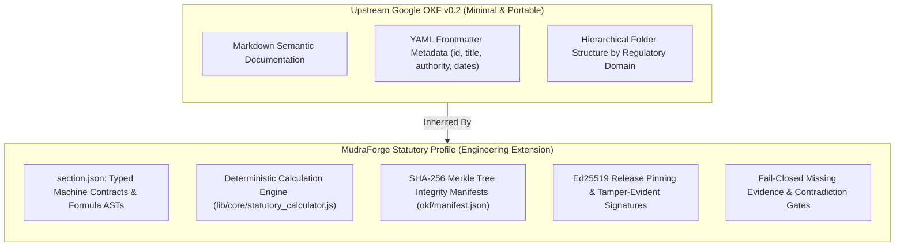
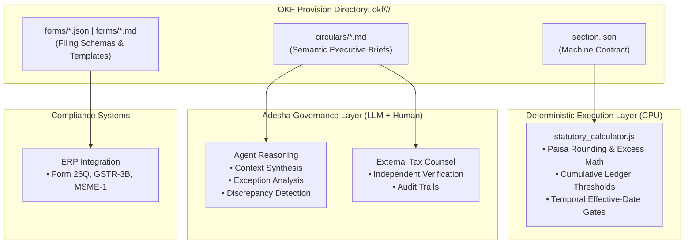
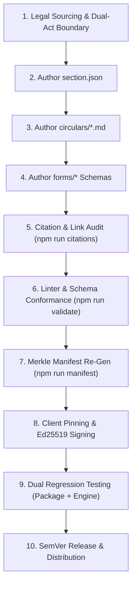

# OKF Statutory Profile: Maintenance Standard Operating Procedure (SOP)

> **Document Version**: 1.1.0  
> **Classification**: Normative Engineering & Release Governance Standard  
> **Target Substrate**: `@mudraforge/statutory` & Adesha Governance Runtime  
> **Base Specification**: Open Knowledge Format (OKF) v0.2 (Upstream Google Specification)  
> **Extension Profile**: MudraForge Statutory Knowledge Profile v0.2  

---

## 1. Purpose, Authority & Governance Boundary

This Standard Operating Procedure (SOP) establishes the mandatory release discipline, authoring conventions, citation standards, cryptographic integrity controls, and verification protocols for the MudraForge Statutory Knowledge Substrate (`@mudraforge/statutory`).

### 1.1 Release Control vs. Legal Correctness
This SOP functions as a **reproducible release control and engineering quality discipline**, not as proof of absolute statutory correctness or judicial finality:
- Passing all tests establishes conformance to the **tested requirements, mathematical formulas, and documented edge cases**. It does not independently prove that every legal interpretation is infallible or that government citations will remain valid indefinitely.
- In accordance with regulatory AI governance principles—such as those articulated in the Reserve Bank of India (RBI) 2025 FREE-AI Committee Report (*Free and Responsible Exploration of AI in Finance*)—automated toolkits, deterministic validators, and algorithmic guardrails exist to support institutional risk management, auditability, and validation. They are **decision-support controls**, never legal or statutory substitutes for an enterprise's own fiduciary governance, internal financial controls, or qualified tax counsel.

### 1.2 Target Failure Modes
This SOP is enforced to systematically prevent:
1. **Link Rot & Citation Drift**: Broken government URLs that degrade external inspectability and audit confidence.
2. **Behavioral & Calculator Drift**: Discrepancies between deterministic code calculators, LLM prompt directives, and primary legislative truth.
3. **Rollback, Replay & Tamper Vulnerabilities**: Malicious substitution, stale bundle replay, or unauthorized manipulation of statutory rules.
4. **Sub-Domain Collisions**: Heuristic false matches between single-digit or composite statutory sections (e.g. Section 8, Section 9(3), Section 194C).

---

## 2. Upstream OKF Specification vs. MudraForge Statutory Profile

To preserve architectural clarity, this standard strictly distinguishes between upstream Open Knowledge Format (OKF) conformance and MudraForge's additional statutory engineering profile:



### 2.1 Upstream OKF Conformance
Upstream Google OKF is a lightweight, portable knowledge representation designed for cross-agent interchange. It standardizes:
- Markdown-based legal narratives with structured YAML frontmatter.
- Hierarchical folder trees organized by regulatory jurisdiction and domain.
- Self-contained, portable knowledge artifacts that can be ingested by any LLM or knowledge base.

*Upstream OKF does NOT prescribe a specific calculation engine, machine-readable JSON schema, cryptographic release pipeline, or transactional runtime.*

### 2.2 The MudraForge Statutory Profile
The MudraForge Statutory Profile introduces additional normative engineering conventions on top of OKF to enable high-assurance financial automation:
- **Typed Machine Contracts (`section.json`)**: Eliminates heuristic interpretation of numeric thresholds, currency values, and applicability conditions.
- **Deterministic Computation**: All threshold comparisons, tax rates, excess math, and rounding execute through deterministic code on CPU (zero LLM token generation for numbers).
- **Cryptographic Release Verification**: SHA-256 Merkle trees and Ed25519 digital signatures guarantee byte-level non-tampering from edge to endpoint.
- **Fail-Closed Evidence Gates**: Rejection or quarantine of transactions when statutory evidence is incomplete, unverified, or contradictory.

---

## 3. Architectural Separation & Testable Guarantees

Every statutory provision in the MudraForge profile maintains a strict division of responsibility across three distinct artifact types:



### 3.1 Testable Guarantees
Rather than making unprovable claims of "zero hallucination", the MudraForge profile operates under four testable and verifiable guarantees:

1. **Deterministic Execution**: Calculations execute exclusively through deterministic code. Given identical inputs, rules, and effective dates, the resulting tax calculations, cumulative thresholds, and paisa rounding are mathematically invariant across all runs.
2. **Versioned Applicability**: Legal applicability is evaluated against versioned rules, notified effective dates, and explicit statutory sunset boundaries (e.g. Section 206C(1H) sunset on 1 April 2025; Section 393 effective 1 April 2026).
3. **Fail-Closed Handling of Uncertainty**: Missing, incomplete, or contradictory evidence triggers a fail-closed outcome (holding payments, flagging discrepancies, or requesting missing links) rather than manufacturing assumptions.
4. **Independent Verification**: Test fixtures verify specified behaviors, edge cases, and arithmetic against independent statutory ground truth rather than trusting agent self-reports.

### 3.2 Artifact Responsibilities

| Artifact | Primary Consumer | Content Mandate | Operational Role |
|---|---|---|---|
| [`section.json`](file:///d:/work/packages/statutory/okf/direct_tax/tds_goods_194q/section.json) | **Deterministic Engine Runtime** | Typed numbers, effective dates, boolean applicability conditions, and threshold formulas. | Machine execution on CPU. Prevents mathematical drift, rate confusion, and arithmetic errors. |
| `circulars/*.md` | **LLM Agents & Human Auditors** | Semantic legal context, executive interpretations, judicial precedents, and YAML frontmatter. | Cross-domain reasoning, statutory crosswalks, exception argumentation, and human auditability. |
| `forms/*` | **Compliance & Reporting Systems** | Machine-evaluable JSON schemas and Markdown return checklists. | Return preparation, ERP writeback payloads, and statutory disclosure schedules. |

---

## 4. Citation & Link Integrity Protocol

To prevent link rot caused by frequent government portal redesigns and CMS migrations, OKF provisions must follow the **Dual-Tier URL Standard**:

### 4.1 Tier 1: Canonical Authority Landing Pages
Direct PDF download paths on government websites frequently change or break during CMS updates. Therefore, official citation URLs must point to canonical, evergreen regulatory landing pages:
- **CBDT / Direct Tax Circulars**: `https://www.incometaxindia.gov.in/pages/communications/circulars.aspx`
- **CBDT Notifications**: `https://www.incometaxindia.gov.in/pages/communications/notifications.aspx`
- **Income-tax Act Provisions**: `https://www.incometaxindia.gov.in/pages/acts/income-tax-act.aspx`
- **CBIC / GST Circulars & Notifications**: `https://taxinformation.cbic.gov.in/`
- **MSME Policies & Office Memorandums**: `https://dcmsme.gov.in/` or `https://msme.gov.in/`
- **MCA Notifications & Orders**: `https://www.mca.gov.in/`
- **RBI Master Directions**: `https://www.rbi.org.in/`
- **Supreme Court of India**: `https://sci.gov.in/`
- **ICAI Standards & Guidance Notes**: `https://www.icai.org/`
- **US Internal Revenue Service (IRS)**: `https://www.irs.gov/`

### 4.2 Tier 2: Legal Instrument Metadata
In `section.json`, the legal instrument itself must be fully described so that statutory provenance is preserved even in offline or air-gapped environments:
```json
{
  "authority": "Central Board of Direct Taxes (CBDT)",
  "instrument": "Circular No. 13 of 2021 (Dated 30 June 2021)",
  "subject": "Guidelines under section 194Q of the Income-tax Act, 1961 - Threshold calculation & advance netting",
  "officialUrl": "https://www.incometaxindia.gov.in/pages/communications/circulars.aspx"
}
```

### 4.3 Domain Whitelist Enforcement
All citation URLs must belong to the regulatory domain whitelist defined in [`scripts/verify_citation_links.js`](file:///d:/work/packages/statutory/scripts/verify_citation_links.js). Citations to commercial blogs, paywalled content aggregators, or unvetted third-party websites are prohibited.

### 4.4 Protocol Security & TLS Trust
- **100% HTTPS Enforcement**: Insecure `http://` links are rejected by the linter.
- **Government PKI Recognition**: Automated link verification recognizes leaf certificates issued by the Government of India Controller of Certifying Authorities (CCA / NIC CA).

---

## 5. The 10-Step Release Control Lifecycle

Whenever authoring, updating, or amending a statutory provision, this 10-step quality discipline must be executed sequentially:



### Step 1: Legal Sourcing & Dual-Act Temporal Boundary
1. Identify primary legislation: Act name, Section number, notified effective date.
2. Determine temporal classification:
   - `ACTIVE`: Currently in force under current legislation.
   - `SUNSET_SUPERSEDED`: Subject to statutory sunset (e.g. Section 206C(1H) on 1 April 2025).
   - `FUTURE_LAW`: Enacted forward law (e.g. Income-tax Act, 2025 Section 393 on 1 April 2026).
3. Enforce deterministic calculator isolation in `statutory_calculator.js`.

### Step 2: Author `section.json` Machine Contract
- Declare mandatory fields: `sectionId`, `sectionCode`, `aliases`, `governingStatute`, `statutorySection`, `successorStatute`, `successorSection`, `title`, `effectivePeriod`, `plainTextSummary`, `keyStatutoryThresholds`, `officialCitations`, `requiredDocumentChecklist`, `tier`, `version`.
- Standardize all search aliases in lowercase or official legal codes (e.g. `["194q", "sec194q", "tds goods"]`).

### Step 3: Author Circulars (`circulars/*.md`)
- Enforce strict YAML frontmatter (`id`, `title`, `authority`, `date`, `statutory_section`, `valid_from`, `valid_to`, `temporal_status`, `subject`, `official_url`).
- Provide clear executive summaries detailing commercial application, tax base unbundling rules, and statutory exceptions.

### Step 4: Author Compliance Forms (`forms/*`)
- Supply machine-evaluable JSON schemas or Markdown checklists for compliance returns and statutory disclosures.

### Step 5: Citation & Link Integrity Audit
Run the automated citation verification suite:
```powershell
npm run citations
```
To run live network probing across all endpoints:
```powershell
node scripts/verify_citation_links.js --live
```
*Pass Criteria*: 0 syntax errors, 0 unauthorized domains, 0 HTTP failures.

### Step 6: Schema Conformance & Syntax Validation
Validate structure and conformance against test fixtures:
```powershell
npm run validate
npm run conformance
```
*Pass Criteria*: 100% schemas valid, 12/12 conformance fixtures passing, 0 defects.

### Step 7: Cryptographic Merkle Manifest Re-generation
Recompute per-file SHA-256 hashes and update the root Merkle digest:
```powershell
npm run manifest
npm run manifest:check
```
Record the resulting root hash in release notes.

### Step 8: Client Pinning & Trust Anchor Verification
1. Add the updated root digest to `PINNED_RELEASE_ROOTS` in [`src/index.js`](file:///d:/work/packages/statutory/src/index.js).
2. For remote edge synchronization, verify Ed25519 digital signature validation against the MudraForge Root Authority.

### Step 9: Dual Regression Testing
Execute both package unit tests and the core engine verification suite:
```powershell
# 1. Package Regression Suite (49 tests)
npm run test

# 2. Engine Unified Test Runner (68 suites)
npm --prefix ../../mudraforge-sarvam test

# 3. Adesha Benchmark Runner (6 scenarios)
node ../../mudraforge-sarvam/tests/benchmarks/adesha_benchmark_challenge_01_runner.js
```
*Pass Criteria*: 100% passing across all 123 test suites and benchmark scenarios with 0 regressions.

### Step 10: SemVer Release & Distribution
1. Bump package version in `package.json` and synchronize `STATUTORY_CLIENT_VERSION` in `src/index.js`.
2. Document all changes in `CHANGELOG.md`.
3. Publish package to the public registry: `npm publish --access public`.
4. Deploy / seed edge catalogs on Cloudflare Workers KV.
5. Verify in a clean downstream consumer project (`scratch/fresh_public_npm_consumer`).

---

## 6. Anti-Drift & Security Invariants

All engineers and automated agents contributing to OKF provisions must uphold five mandatory invariants:

| Invariant | Operational Requirement | Verification Mechanism |
|---|---|---|
| **Rule 2: Stale Reference Scan** | After renaming or deprecating any provision, scan the entire codebase for stale references. | PowerShell `Get-ChildItem -Recurse \| Select-String` returns zero matches. |
| **Rule 3: Single Execution Path** | No duplicate inline calculators. All dispatchers delegate to canonical `statutory_calculator.js`. | Unit tests confirm identical mathematical output across all entrypoints. |
| **Rule 4: Regex User Input Escaping** | User-supplied search queries must be sanitized with `replace(/[.*+?^${}()\|[\]\\]/g, '\\$&')`. | Unit tests verify queries containing `(`, `)`, `[`, `]`, `*`. |
| **Rule 5: No Dead Schema Parameters** | Every parameter declared in `section.json` must be evaluated by the execution runtime. | Parameter mapping audit in `statutory_commons.js`. |
| **Rule 11: Statutory Truth Over Engine Output** | Calculations and effective dates must match independent legal ground truth, not merely agent agreement. | Parameterized test suites testing cumulative prior purchases and temporal dates. |

---

## 7. Verifiable Release Artifacts & Evidence Ledger

Claims of test passage and release integrity are substantiated by the following reproducible artifacts:

| Verification Layer | Active Release Evidence | Location / Verification Command |
|---|---|---|
| **Cryptographic Root** | `sha256-3f25fc3941d29de5b8befc0ddb24d1bb2632067f00b200680cf784961616424c` | `npm run manifest:check` across all 59 files |
| **Citation Network Liveness** | 70/70 passing citations across 13 regulatory domains (0 failures) | `node scripts/verify_citation_links.js --live` |
| **Statutory Schema Conformance** | 18/18 sections, 19 circulars, 22 forms passing OKF v0.2 linter | `npm run validate` |
| **Package Regression** | 49/49 test suites passing with 100% reproducible precision | `npm run test` in `packages/statutory` |
| **Engine Invariant Regression** | 68/68 test suites passing across governance runtime and TLA+ oracles | `npm test` in `mudraforge-sarvam` |
| **Adesha Benchmark Challenge 01** | 6/6 scenarios scored (Base 100/100, Variants A-E verified) | `node mudraforge-sarvam/tests/benchmarks/adesha_benchmark_challenge_01_runner.js` |
| **Live NPM Consumer** | Installed and verified live from registry in clean consumer | `node scratch/fresh_public_npm_consumer/test_live_npm_benchmark.js` |

---

## 8. Pre-Flight Maintenance Checklist

Before closing any maintenance task or cutting a new release, verify that each item is completed:

- [ ] All 18 statutory provisions contain complete and valid `section.json` contracts.
- [ ] Every citation URL uses `https://` and resolves to an approved regulatory domain.
- [ ] `npm run citations` reports 0 defects and 0 unauthorized domains.
- [ ] `npm run validate` passes with 0 schema errors.
- [ ] `npm run conformance` passes 12/12 fixture tests.
- [ ] `npm run manifest:check` verifies all 59 files against SHA-256 digests.
- [ ] `PINNED_RELEASE_ROOTS` in `src/index.js` includes the active manifest root hash.
- [ ] Two-pass precision lookup correctly resolves single-digit sections (`8`, `9(3)`).
- [ ] All 49 package tests and 68 engine regression suites pass with 0 failures.
- [ ] Stale reference scan returns zero matches for deprecated names or legacy domains.
- [ ] Version number in `package.json` exactly matches `STATUTORY_CLIENT_VERSION`.
